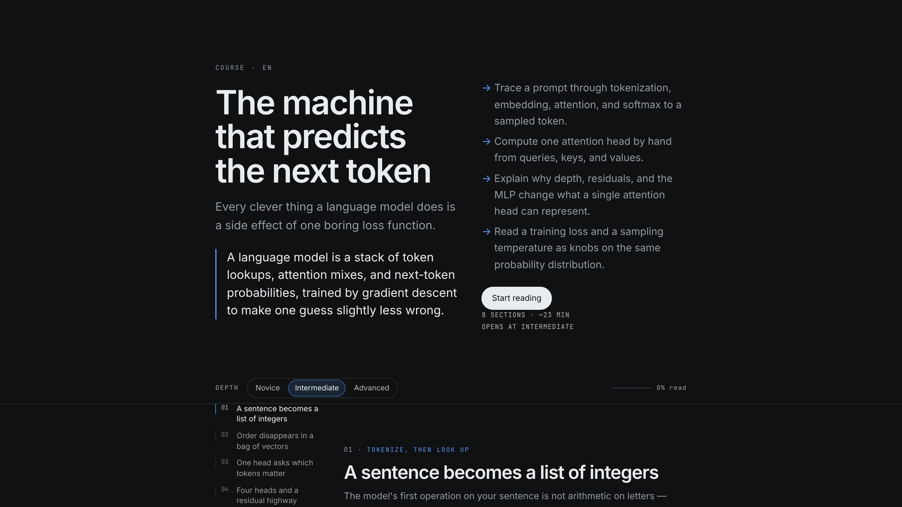
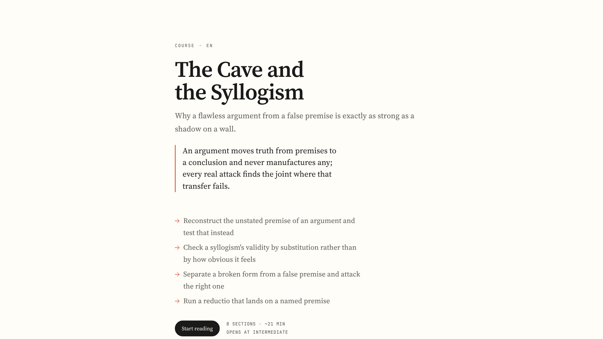
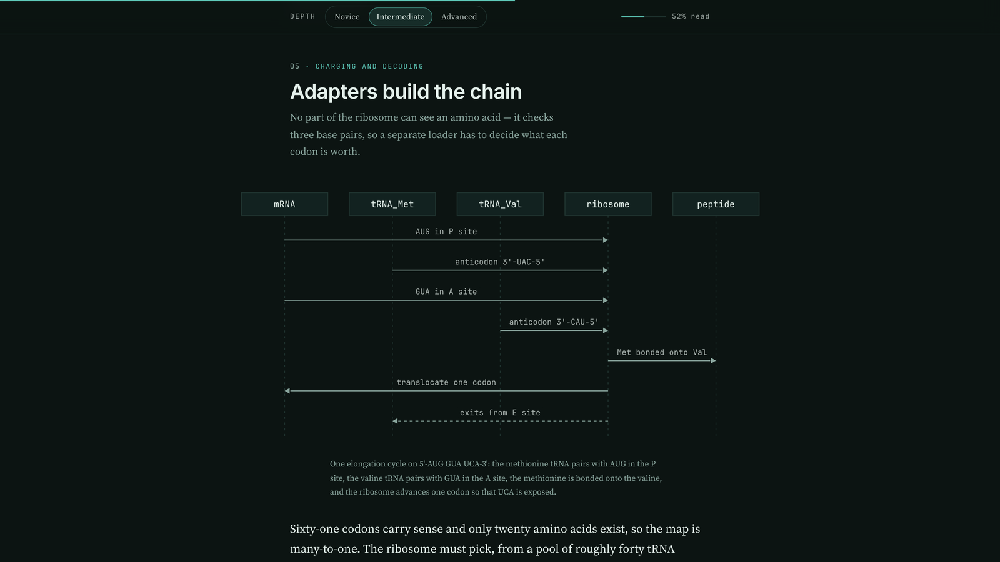
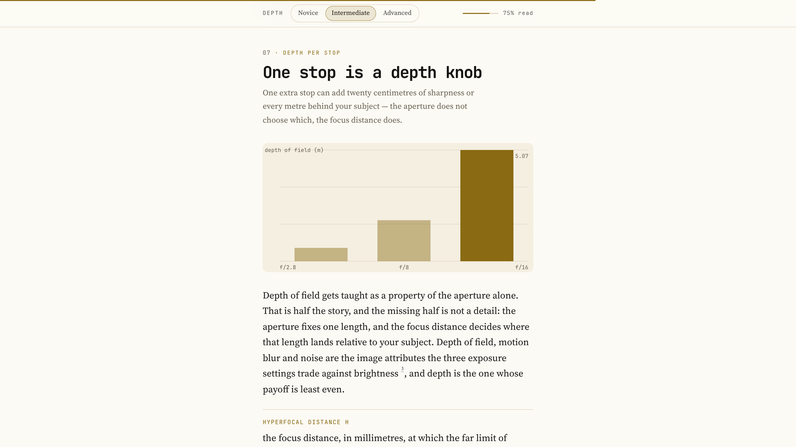

# coursewright

coursewright builds a self-contained HTML course on any topic. It writes the same material at
three depths, novices first, and switches between them in place without a reload. A course has
figures, exercises with feedback, recommended videos and reading, and a footer listing every
source it read.

## What it looks like

Four courses, each given its own identity by the rotation — same renderer, different palette,
type pairing and layout:

| | |
|---|---|
|  |  |
|  |  |

Figures are drawn from the section's own outline — a sequence diagram for a mechanism, a chart
when the numbers are the point:




## Install

```bash
hermes plugins install coursewright                          # from the catalog, once listed
hermes plugins install NehuenD/hermes_coursewright           # from the repository today
hermes plugins install NehuenD/hermes_coursewright --ref <40-character-commit>
```

The install asks `Enable 'coursewright' now? [y/N]` and defaults to no; `--enable` or
`--no-enable` skip the prompt. If you answered no, turn it on afterwards:

```bash
hermes plugins enable coursewright
```

It also asks before installing its four Python dependencies (httpx, Pillow, yt-dlp,
youtube-transcript-api). `--yes-deps` answers that for a scripted install; `--no-deps` installs
without them, which leaves videos and thumbnails off. `--ref` pins a full commit and
`hermes plugins update` will not move a pinned copy. Copied into
`$HERMES_HOME/plugins/coursewright` by hand instead, restart Hermes or start a new session.

No API keys are needed, but it does need the network: the host model writes the course and the
sources are read from the web. Nothing else has to be configured — research uses whatever web
tools the host has, falls back to Wikipedia, arXiv and Stack Exchange when search returns
nothing, and reads pages with a built-in reader when the host's extractor cannot.

## Use

```
coursewright_plan(topic="how a transformer works")     plan first, cheap
coursewright_build(topic="how a transformer works")    plan and write in one call
coursewright_build(plan_path=".../plans/x.json")       write from a saved plan
coursewright_build(spec_path=".../course.json")        render an existing spec
coursewright_list()                                    courses on disk
coursewright_status()                                  what the host can do, last build
/course <topic> [--level=novice|intermediate|advanced] [--lang=es] [--sections=N]
/courses [slug]
```

A build writes `$HERMES_HOME/plugin-data/coursewright/courses/<slug>/index.html` and a copy in
`~/Courses/<slug>/`, with the spec, the research record and any editable figures beside the page.

`/course` returns at once and hands the build to the agent as a turn, so progress is visible and
the finished course arrives in the conversation. If no live session can be woken, it falls back
to a background build that posts its result.

**Reading a course.** `j`/`k` or the arrows move between sections, `1`, `2` and `3` set the depth,
`g` returns to the top; typing in an answer box does not trigger them. Depth is an attribute on
the document, so switching re-voices the text in place and moves nothing. Progress, depth and
answers persist in `localStorage` under `coursewright:<slug>`. Print drops the rail, the buttons
and the posters, labels each level, and re-colours the figures as line art.

## How it works

1. **Plan.** One cheap call: title, thesis, outcomes, section briefs — each with the mechanism it
   establishes and the worked example it carries — and a page identity.
2. **Research.** Find, read and watch, probing each rung before using it.
3. **Draft.** One call per section, carrying the outline and numbered source excerpts so a claim
   can point back with a `[n]` marker.
4. **Picks.** A small call selects videos and reading and tags each with a depth.
5. **Assemble.** A section that fails twice is rebuilt thin and flagged; one that wrote steps but
   no figure gets a flow figure drawn from those steps.
6. **Render.** `spec.py` validates, `render.py` draws. The model never writes HTML or CSS.

| rung | uses | when it is missing |
|---|---|---|
| find | host `web_search` | keyless finders: Wikipedia, arXiv, Stack Exchange |
| read | host `web_extract` | a configured scraper, then a built-in `urllib` reader |
| watch | `yt-dlp` | the watch list is empty and the build says why |
| model | `ctx.llm` | the build fails with the reason rather than writing a stub |

`coursewright_status` reports what it found under `environment`.

**What a level has to contain.** Every level runs the same arc: the problem this part solves, the
mechanism step by step, the worked example with its real values, and what it costs or where it
fails. None of the three is a summary.

| level | words | blocks |
|---|---|---|
| novice | 350-500 | 5-7 |
| intermediate | 500-700 | 6-8 |
| advanced | 550-800 | 6-8 |

A level under 300 words is sent back once, and so is one with no `steps`, `code`, `math` or
`timeline` block — that block is where the worked example lives. A failed depth is repaired on
its own rather than redrafting the whole section.

**Cost.** A four-section course is one plan call and four draft calls. An eight-section course
lands near 160 KB and about 4,000 words at novice, 4,800 at intermediate and 5,400 at advanced,
and takes roughly ten minutes: three sections are drafted at once by default, and
`draft_concurrency` sets how many.

**Figures** are drawn, not pasted. A `diagram` (layered graph: architecture, state machine, data
flow, feedback loop) and a `sequence` (parties exchanging messages in time order) are laid out by
the renderer as inline SVG in the page palette, so one drawing serves light, dark and print. The
model supplies nodes, edges and labels; never coordinates, sizes or colours. Each is also written
beside the course as `figures/<section>.excalidraw`, so a reader can open it at excalidraw.com,
move a box and keep the result.

## Configuration

| key | default | meaning |
|---|---|---|
| `default_level` | `intermediate` | depth the course opens at |
| `courses_dir` | `~/Courses` | where the visible copy goes, empty disables it |
| `enable_research` | `true` | search and read before writing |
| `enable_videos` | `true` | look for videos |
| `max_sources` | `12` | pages read per course |
| `max_videos` | `6` | videos collected per course |
| `draft_concurrency` | `3` | sections written at once, 1 to 4; 1 is one at a time |
| `research_timeout` | `150` | seconds spent searching and reading before it writes anyway |
| `firecrawl_url` | `""` | scraper used when the host extractor returns nothing: empty probes a local stack on `http://localhost:3002`, `off` disables it, a full URL points anywhere |
| `firecrawl_key` | `""` | bearer token for that scraper, kept as a Hermes secret (`.env` name `FIRECRAWL_API_KEY`) and read through the secret scope |

**Debugging a build.** `COURSEWRIGHT_DUMP=<dir>` writes each section's raw model reply, and the
version it was coerced into, under that directory. It is off unless you set it yourself; apart
from the course copy under `courses_dir`, it is the only place the plugin writes outside its own
data directory; and it only ever contains prompts and model output.

## What it does on your machine

The whole list, because a plugin that reads the web and runs a tool should say so:

- **Network.** Search queries go to the host's search backend. Pages it finds are fetched over
  HTTP (Wikipedia, arXiv and Stack Exchange directly when no backend answers). `yt-dlp` is
  queried for video metadata, and thumbnails are downloaded and inlined into the page as WebP so
  a course has no external image requests. If you configure a scraper (`firecrawl_url`), pages
  are sent to it.
- **Reads.** Only the pages research found, plus its own files. It does not read your home
  directory, other plugins' data, `.env`, `auth.json` or any credential store.
- **Shell.** One child process: `yt-dlp`, invoked with an argument vector (never a shell), only
  while collecting a watch list, and skipped entirely when `enable_videos` is false.
- **Writes.** Its own directory under `$HERMES_HOME/plugin-data/coursewright/`, and one copy of
  the finished page under `courses_dir` (`~/Courses` by default — point it elsewhere, or set it
  empty to disable the copy). `COURSEWRIGHT_DUMP` is the only other destination, and only when
  you set it.
- **Long-running.** A course takes minutes: one model call per section, three of them at a time
  by default, plus research. Run it in the background (`background: true`, or `/course`) and it
  keeps going after the tool returns, then posts the finished course into the chat. Nothing is
  left running after a build ends.
- **Credentials.** None of its own. The optional scraper key is a `secret` config key, stored
  and read through Hermes' secret scope; the model calls use the host's own provider.
- **Telemetry.** None.

## Limits

- The model never writes HTML or CSS. The renderer drops an unknown block kind with a warning
  instead of rendering it raw.
- A course cannot claim research it did not do. With no sources the page prints an Unresearched
  notice, and the footer says what happened in words, never a count of zero: "written without a
  research pass, no outside sources were read, 2 dead ends". A course with videos but no
  readable page says the videos were checked for relevance, not accuracy.
- A citation cannot point at a page that was not read. Markers resolve into the footer list, and
  a marker past the end of that list is dropped rather than linked to nothing.
- A model that calls a blog post a paper gets corrected, and a year survives only when it appears
  in the source text.
- A figure whose shape makes no sense is dropped with a build note instead of taking the render
  down. Comparisons in prose (`n < 3`, `a >= b`, `Vec<T>`) survive as text.
- The relevance filter drops a video about the wrong sense of the topic, and the build note says
  how many it dropped. Transcripts are detected and reported, not quoted at a timestamp.
- The page can send a message only where the host injects `window.hermes` — the chat's inline
  preview frame. Opened as a file or in the desktop preview pane, the ask buttons fall back to
  the clipboard and say plainly when the copy was refused. An opaque-origin frame has no
  storage, so there the page runs stateless.
- Grading is split: the rubric check runs locally and answers at once, and "Ask Arden to grade
  it" sends the question, the rubric and the answer into chat. Exercise kind alternates by
  section, multiple choice then recall, so both paths exist in every course.
- A slash command has a 30 second budget in the desktop client, so `/course` hands the build to
  the agent rather than building inside the command. One build per topic at a time: a second
  request for a topic already being built is refused instead of racing the first.
- A running gateway holds the plugin modules it loaded. After changing the code, start a new
  session or restart the gateway.

## Files

| file | role |
|---|---|
| `plugin.yaml` | manifest, tool list, config schema |
| `__init__.py` | registration, the four tools, `/course` and `/courses` |
| `author.py` | plan, draft, repair, resource picks, prompt construction |
| `research.py` | the find, read, rescue and watch rungs, caching, deduplication |
| `spec.py` | spec validation and the closed block set |
| `render.py` | the page: HTML, CSS, JS, figures, print rules |
| `tokens.py` | the design token space and identity assignment |
| `tests/` | regression tests for validation, rendering, research and the commands |
| `samples/collatz.json` | a real six section course, three depths per section |

## Verify

```bash
hermes plugins doctor .
hermes plugins validate . --install-deps
python3 -m unittest discover -s tests -t .   # regression tests, no network
```

## License

MIT. See `LICENSE`.
