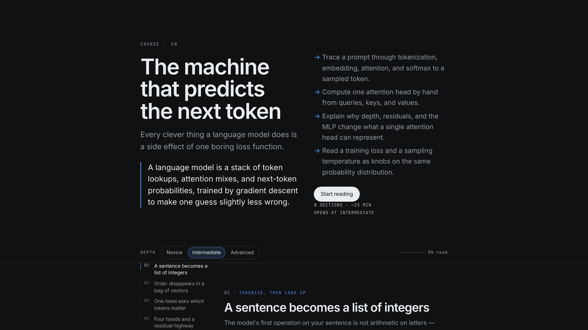
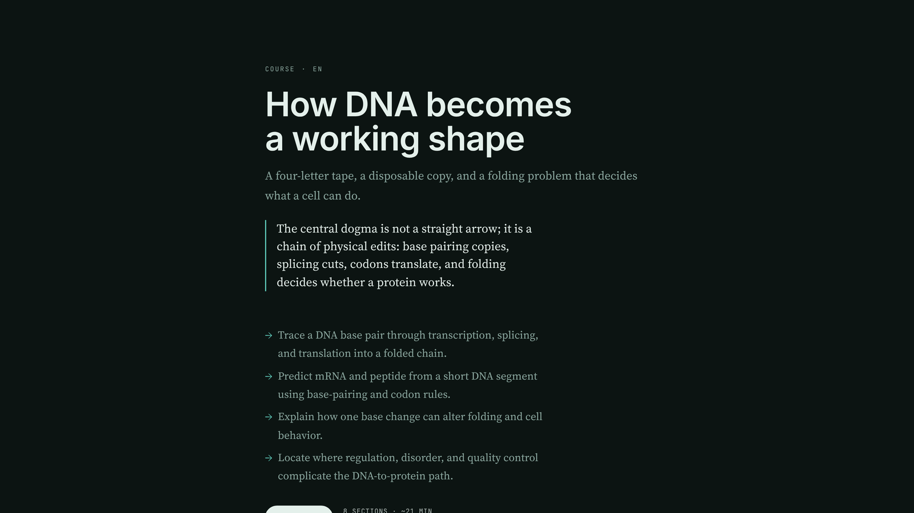

# Catalog PR — body text for `plugin-catalog/coursewright.yaml`

Open a PR against `NousResearch/hermes-agent` that adds one file,
`plugin-catalog/coursewright.yaml`, with the contents of
[`catalog-entry.yaml`](../catalog-entry.yaml). Paste this into the description.

---

## coursewright — a topic becomes a course you can read

`/course the central dogma of molecular biology` (or `coursewright_build`) turns a subject
into one self-contained HTML page, written at three depths that switch in place, with figures,
exercises that answer back, videos and reading, and a footer listing every source that was
actually read.

**Why it is more than a prompt.** The model never writes HTML. It fills a validated spec —
sections, prose per depth, an exercise, a figure described as nodes and edges — and a renderer
draws the page: layered diagram geometry with edge routing, sequence diagrams, themed inline
SVG that follows the reader's light/dark setting and survives print, aligned math, and a
provenance footer. Validation is a hard boundary that never raises on model output, a refused
model fails the build instead of writing a stub, writes are atomic under a cross-process lock,
and the visual identity of each course is assigned in code from what is already on disk.

**Surfaces used.** Four tools (`coursewright_plan`, `coursewright_build`, `coursewright_list`,
`coursewright_status`), a `/course` and `/courses` slash command, `ctx.llm` for the one call per
section, `ctx.state`, `ctx.post_message` with an injected-turn fallback, and the host's own
`web_search` / `web_extract` when they exist.

**Disclosure.** Needs network access. The course is written by the host model through
`ctx.llm`; pages are read over the web with the host's extractor, a configured scraper, or a
built-in reader; video lookups run `yt-dlp` and `youtube-transcript-api` for metadata,
captions and thumbnails. It writes only its own plugin data directory plus an optional copy
under `~/Courses`, which the user can point elsewhere or disable. It owns no credentials: the
optional scraper key is declared as a `secret` config key and read through Hermes' secret
scope. No telemetry.

**Reliability.** Every optional dependency degrades to "feature off, and the course says so":
research off, no sources found, no videos, a scraper that refuses. `coursewright_status`
reports what the host can actually do. 98 tests, no network in the suite.

**Screenshots** (four identities written by the same renderer, two figures):

**Validation.** `hermes plugins validate /path --install-deps` passes: manifest, `requires_hermes`,
config schema, loadability, capability probe, declared/registered tool parity, no built-in tool
collisions, security scan, `no core override`, and dependency resolution inside Hermes' core
constraints. One advisory: `post_message` is in-process only, and the plugin falls back to an
injected turn when it is refused.

---

## After the PR

1. The form can be submitted as soon as the PR is open:
   <https://form.typeform.com/to/FwJLvOln> — needs the PR link and the video link.
2. Post the demo (< 90 s) on X tagging `@NousResearch`.
3. Deadline: **5PM EST, 11 Nov 2026** — that is 19:00 in Buenos Aires (UTC−3).
